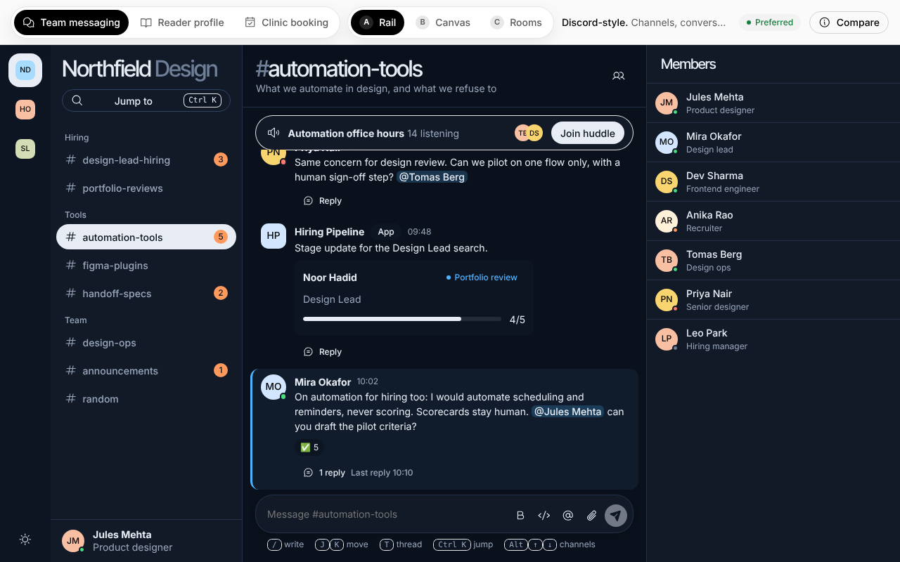
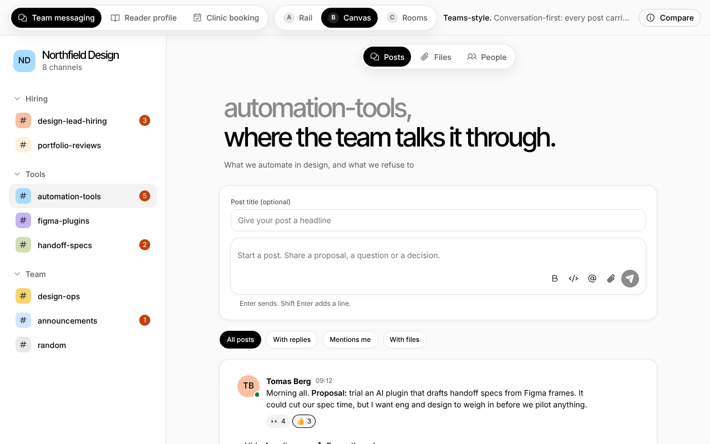
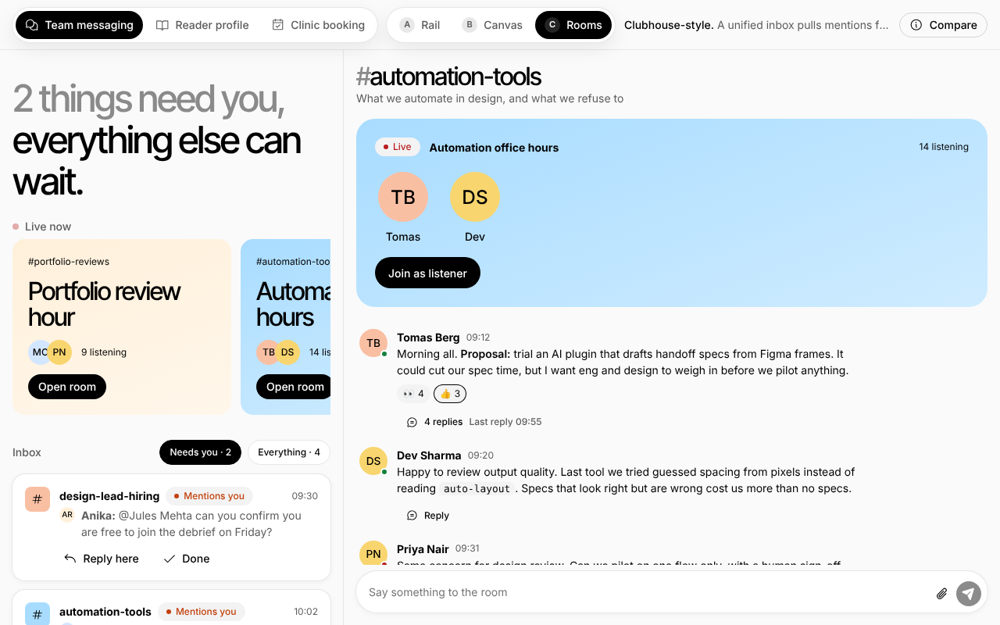
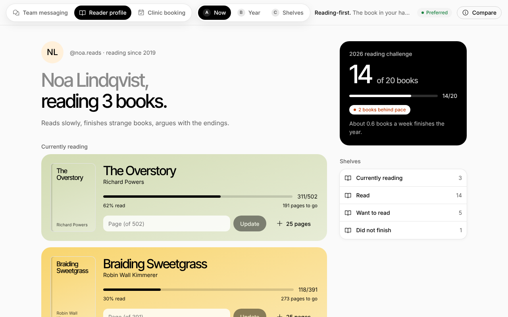
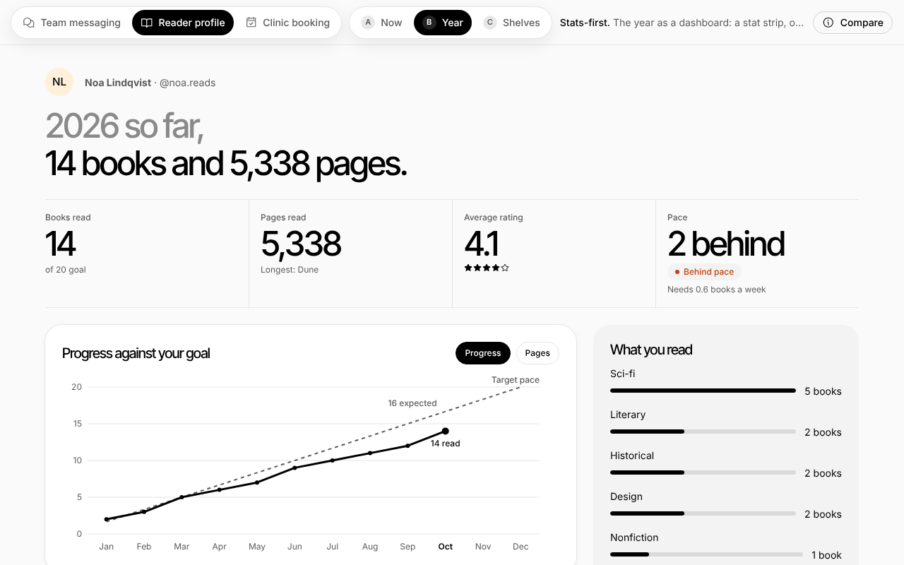
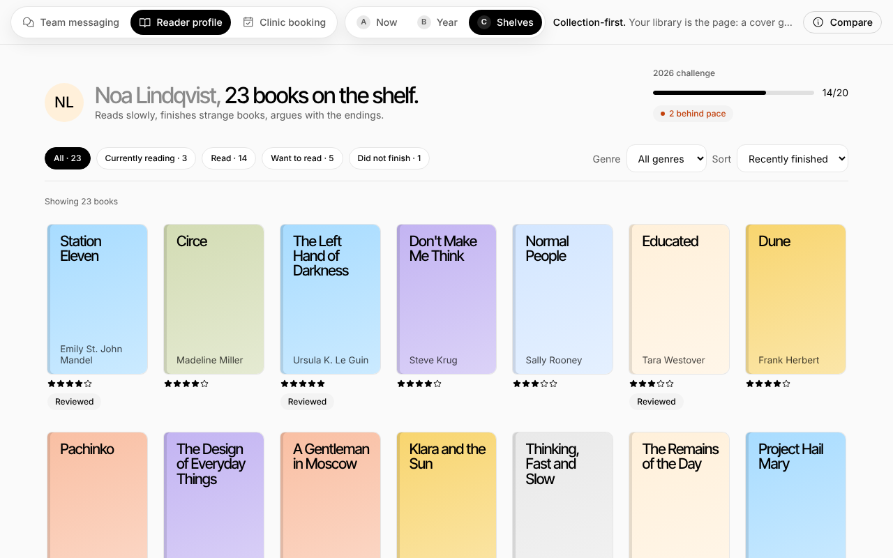

# Pazcare design assignment

A reusable design system and Claude Code skill extracted from a UX portfolio, applied to two products it had never seen (a team messaging app and a Goodreads-style reader profile), plus a third unfamiliar brief to test the skill. Built with React, TypeScript and Vite, using Claude Code.

## Run it

```bash
npm install
npm run dev          # http://localhost:5173
npm run build        # type-check + production build
npm run test:e2e     # builds, serves, runs all browser checks (see Testing)
```

Needs Node 18+. No backend: all state is local React state and resets on reload. Open any layout directly: `#/messaging/rail`, `#/reader/now`, `#/booking/flow`. The bar at the top switches product and concept; **Compare** shows each concept's core idea and why it is or is not preferred.

## The layouts

| Product | Concept | Core idea | Preferred? |
|---|---|---|---|
| **A. Team messaging** (hiring and design-automation team) | **Meetify** (keyboard-driven) | Channels, thread and composer in view together, driven from the keyboard (Ctrl+K, j/k/t) | **Yes** |
| | **Canvas** (conversation-first) | Every post carries its thread inline, so replies are the main reading experience | |
| | **Rooms** (unified inbox) | One inbox of mentions across all channels, reply in place, live huddles one tap away | |
| **B. Reader profile** | **Now** (reading-first) | The book in your hands leads: update your page in two taps, challenge and shelves in a side rail | **Yes** |
| | **Year** (stats-first) | A stat strip, one chart of progress against the goal, then what you read | |
| | **Shelves** (collection-first) | The library is the page: cover grid, filters, every book editable in a side sheet | |
| **Skill test** | **Booking flow** | An appointment flow from an unfamiliar brief, built using only the skill | n/a |

**Why Meetify (A).** It is the only messaging concept showing channels, a thread and the composer together at desktop width, and the command menu and shortcuts serve the high-frequency scanning job. It depends on the dark theme, which is inferred (the portfolio has none), so Canvas is the safer on-brand alternative for async teams.

**Why Now (B).** A reader opens their profile to log where they are, so the current book and the page counter lead. It keeps the portfolio's editorial feel without dashboard noise. Year answers "am I behind?" best, and Shelves is best for curating a big library, but each demotes the daily action.

| | | |
|---|---|---|
|  |  |  |
|  |  |  |

## Structure

```
src/design-system/        tokens.css, components.css, 10 components (Button, Input, Card, Tag, Nav, List, Sheet, Avatar, Banner, Meter)
src/products/messaging/   Meetify, Canvas, Rooms + shared composer, message, thread, workspace state
src/products/reader/      Now, Year, Shelves + shared data, derived stats, cover and rating components
src/products/booking/     skill-test product
src/products/registry.tsx product and concept registry, hash routing
skills/roshyoui-design-system/   SKILL.md + references/
docs/                     provenance.md, principles.md, components.md, validation.md, screens/
tests/                    e2e/*.py and run.sh
```

## Design system

Tokens (colour, type scale, spacing, radius, elevation, motion) live in `src/design-system/tokens.css`. Documentation:

- `docs/principles.md`: the visual identity, responsive rules and accessibility rules.
- `docs/components.md`: each component's behaviour, and the decision taken for every gap the portfolio does not define.
- `docs/provenance.md`: **what is measured and what is inferred.**

**Provenance in one paragraph.** The live portfolio could not be fetched from the build environment, so nothing comes from its source. Colours were **measured from the two supplied screenshots**: canvas `#fafafa` and ink `#000000` exactly, card tints within a few units. Font families (Inter Tight and Inter), **Phosphor icons**, all motion values, the dark theme and status colours are **inferred and unverified**, and `docs/provenance.md` says how to verify each. The Phosphor assumption in particular is not confirmed.

## The skill

`skills/roshyoui-design-system/SKILL.md` plus `references/` (structure by job, the gap ladder, a verification checklist, and lessons from bugs found while building). To use it in Claude Code, copy or symlink the folder into `.claude/skills/`:

```bash
mkdir -p .claude/skills && cp -r skills/roshyoui-design-system .claude/skills/
```

## Testing

`npm run test:e2e` builds the app, serves it, and runs three Playwright suites (Chromium) with axe-core accessibility scans, then stops the server. One-time setup: `pip install playwright` and `python3 -m playwright install chromium`.

| Suite | Checks | axe scans | Covers |
|---|---|---|---|
| messaging | 67 | 3 | default view shows channels, conversation, thread and composer; Favorites, Channels and Direct messages sections, favoriting, new message, DMs, meet (audio or video call), send, @mention picker, command menu, shortcuts, thread reply, filters, inbox reply, Done and Undo, huddle, mobile menus |
| reader | 24 | 5 | page logging and validation, finishing a book, empty state, chart and month filter, shelf filters and sort, side sheet edits |
| booking | 18 | 4 | step gating, focus management, validation, back keeps data, confirmation, mobile summary |

All 109 checks pass and axe reports zero WCAG 2 A/AA violations in the scanned states. Layouts were also checked at 390, 768 and 1280px for horizontal overflow. **Not tested:** screen readers, real touch devices, Safari, Firefox; and axe was run on default and sheet-open states, not every state.

## Skill validation

Summary (full report in `docs/validation.md`): the skill carried the system to a stepwise booking flow with almost no new components, because the gap ladder resolved most needs at rung 1 or 2. It also exposed gaps: no multi-step focus guidance (now added to the skill), no disabled filter chip (added to the system), and no shared radio or select styling (a clear next promotion). **Limit:** the same agent wrote and applied the skill, so this is not an independent test. Running a fresh agent on a second brief is the recommended next step.

## Technical decisions worth knowing

- **Native elements first.** `<dialog>` for sheets, `<progress>` for meters, `<select>`, radio groups and `<details>` for the rest, so keyboard and screen reader behaviour comes free. Product CSS only styles them.
- **One source of truth for numbers.** Reader stats are one pure function of the book list, so the stat strip, chart and challenge card cannot disagree.
- **A fixed demo clock** (`2026-10-26`) keeps "behind pace" maths repeatable.
- **Hand-built SVG chart** sized to its container, with a hidden data table, instead of a chart library for a single chart.
- **No real cover art, no real avatars.** Covers are generated typography on tints. All people, books' reviews and the clinic are fictional.
- **Hash routing** (`#/product/concept`), so every layout has a shareable link and there is no router dependency.

## Known limitations

- Some UI is mocked: Meetify's direct messages are seeded with a few lines and have no real replies, calls are simulated with no audio or video, Canvas's Files and People tabs are light, and huddles have no audio. On Meetify at widths under 1200px the thread opens in a side sheet instead of being visible by default. The booking flow stores nothing and says so on screen.
- Message formatting supports bold, code and mentions only.
- The skill test was not independent (above).
- Dark theme contrast was scanned in Meetify's default view only.
